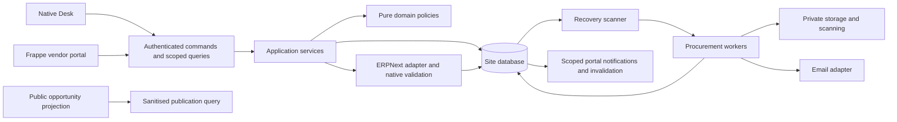

# Application architecture

Owner: PROC-R01, PROC-R03, PROC-R16, PROC-R26, PROC-R28. Decisions: [app baseline](decisions/ADR-001-APP-AND-DESIGN-BASELINE.md), [identity](decisions/ADR-002-IDENTITY-AND-ERPNext-OWNERSHIP.md), [sealed envelopes](decisions/ADR-003-SEALED-BIDS-AND-DURABLE-WORK.md).

## Boundaries and future structure

```text
tag_procurement/
  domain/          # requirement, eligibility, authority, allocation and scoring policies
  application/     # commands, scoped queries, transition/transaction orchestration
  infrastructure/  # Frappe repositories, locks, private storage, scanner, mail, clock
  api/             # authenticated facade and allowlisted public discovery queries
  integrations/    # ERPNext source guards, mappings and reconciliation hooks
  procurement/     # DocTypes, Desk pages, reports and native metadata
  www/             # owned Frappe website routes and portal controllers
  templates/       # website-theme portal components
  public/          # scoped assets and existing icon reuse
  setup/           # repeatable installation and seed helpers
  patches/         # explicit migrations
  tests/           # domain, integration, browser and recovery tests
```

Domain policies accept typed values and return decisions/reasons; no Frappe globals, network or hidden database reads. Application services enforce actor, membership/company scope, revision, authority and policy before writes. Repository ports are narrow, only where used; avoid a generic framework within Frappe. Controllers delegate decisions but guard ordinary save/submit/update-after-submit paths too.



## Transactions and concurrency

Each command owns one database transaction; no partial approval and Supplier creation across commits. Freeze resolved definitions and response hashes atomically at submit. Lock tender submission gate and vendor bid head during submission/opening; lock award allocation/contract remaining balance during approval and order creation. Re-read current state after acquiring locks. Establish lock order: company policy/resource, tender, bid head, award allocation, contract/claim, operation; never reverse order in a competing command.

Idempotency records bind actor, the server-derived non-null scope key, command, key and request hash to the committed result. Same key/different payload fails. Persist events/outbox in the source transaction, enqueue on commit and recover committed work if enqueue fails. Do not call mail/scanner/storage network services while holding business locks.

ERPNext records created on the same site participate in the same transaction and use native controller checks. A mapping uniqueness constraint prevents duplicate orders/invoices after retries. External mail acceptance can be uncertain; represent that honestly and reconcile before retry.

## Sealing and projections

Separate bid head metadata, technical payload and commercial payload into independently permissioned records. Do not store prices in the bid parent, standard Version snapshots, comments, route boot data, notifications or searchable fields. Standard File URLs and attachment lists must not reveal sealed documents; retrieval is through an authorised evidence command after validating the parent envelope stage. See [privacy](PERMISSIONS_AND_PRIVACY.md).

Public opportunities are explicit safe projections of published versions, never guest access to raw Tender records. Portal financial views are small authorised DTOs, not generic ERPNext print contexts. Membership and company filters are recalculated per request and export.

## Installation and configuration ownership

Require ERPNext/Frappe and independently install with no localisation/marketing dependency. Ship owned Desktop Icon, Workspace Sidebar, Workspace, roles, cards and reports using this checkout's metadata. Stable app identifiers must not overwrite Buying metadata. Preserve site-specific configuration during repeat install/migrate. An optional navigation adapter must use a verified extension point and tolerate its absence.

Create an app-level AGENTS.md bridge to this handbook during bootstrap. Version the handbook within the app repository, not an untracked workspace root. Readiness switches start disabled, including publication, submissions and outbound notifications; diagnostics and historical read access remain available to authorised users.
