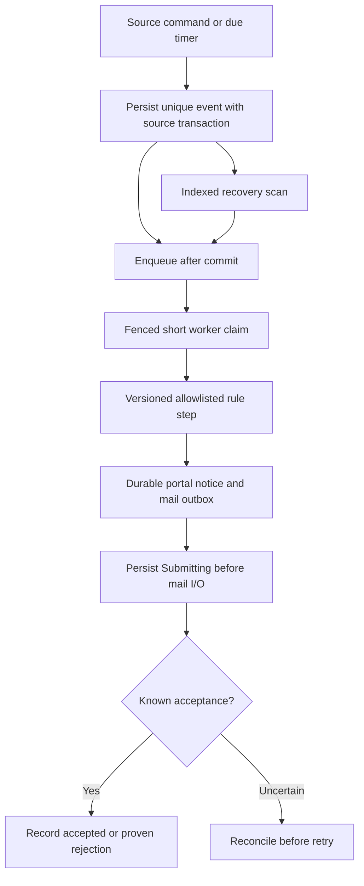

# Durable rules, notices and worker recovery

Policy owner: [specification](../AUTOMATION_AND_RELIABILITY.md); primary UI: [screen](../pages/AUTOMATIONS.md).

## Entry, ownership and transaction boundary

Rules publish immutable allowlisted versions and keep existing runs pinned. Unique event/run/notice keys prevent duplicate logical tasks and portal notices. Recovery finds committed records missed by Redis enqueue.

## Decisions and durable effects

External I/O occurs outside business locks after a durable boundary. Current permissions, source state and optional subscription are checked at dispatch/resume. Essential tender notices are not suppressed by a job-alert opt-out.

## Exceptions and recovery

Expired leases before I/O are reclaimable; stale fencing tokens cannot write outcomes. Possible email acceptance becomes Unknown and requires evidence/disposition. Restored systems start disabled and must reconcile before re-enabling sends or submissions.

## Required verification

[PROC-A14](../TESTING_AND_ACCEPTANCE.md#proc-a14), [PROC-A26](../TESTING_AND_ACCEPTANCE.md#proc-a26), [PROC-A27](../TESTING_AND_ACCEPTANCE.md#proc-a27), [PROC-A29](../TESTING_AND_ACCEPTANCE.md#proc-a29).
