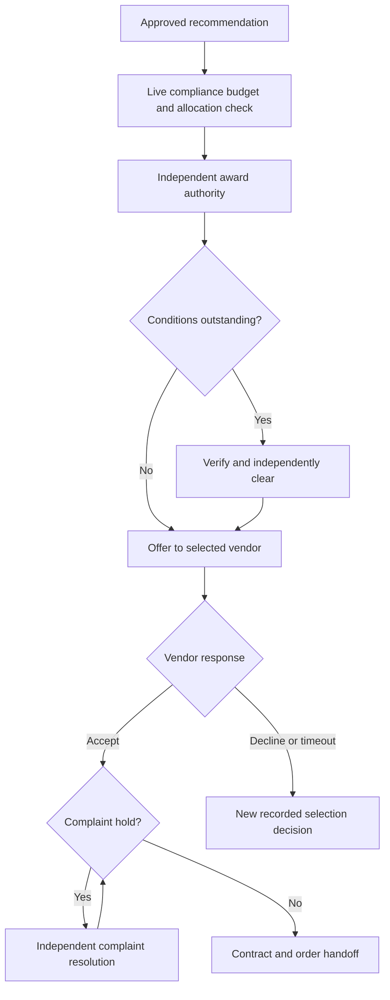

# Award, vendor response and complaint

Policy owner: [specification](../TENDERING_AND_EVALUATION.md); primary UI: [screen](../pages/AWARDS.md).

## Entry, ownership and transaction boundary

Award proposal freezes selected effective offer, lots, quantities, value, conditions and evidence. Lock shared allocation totals so simultaneous split awards cannot exceed approved demand. Approval actor is independent of proposal/recommendation authorship.

## Decisions and durable effects

Only accepted awards with cleared conditions and no timely unresolved complaint proceed. Complaints use the configured policy window and an independent resolver. Essential outcomes are private notices; public results require their own approved safe publication.

## Exceptions and recovery

Decline, expiry, upheld complaint or loss of compliance creates an explicit hold/withdrawal/new decision. There is no automatic runner-up selection. Native documents already created follow accounting cancellation/dependency rules, never deletion from an award screen.

## Required verification

[PROC-A18](../TESTING_AND_ACCEPTANCE.md#proc-a18), [PROC-A19](../TESTING_AND_ACCEPTANCE.md#proc-a19), [PROC-A20](../TESTING_AND_ACCEPTANCE.md#proc-a20), [PROC-A21](../TESTING_AND_ACCEPTANCE.md#proc-a21).
