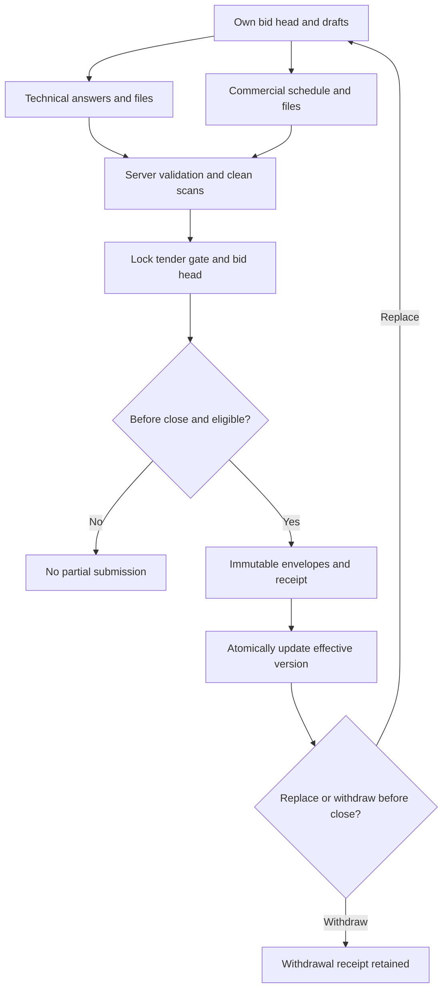

# Sealed bid submission and replacement

Policy owner: [specification](../TENDERING_AND_EVALUATION.md); primary UI: [screen](../portal/BID_WORKSPACE.md).

## Entry, ownership and transaction boundary

Only own authorised draft projections are readable. Submit receives current revision/version/acknowledgements and server-derived actor/time. Both envelopes, receipt and effective-head update commit together; checks at exactly close reject submission.

## Decisions and durable effects

A replacement or unchanged-content reaffirmation against a new tender version uses a new full version/receipt and supersedes only on successful commit. A lost response is resolved by idempotency receipt lookup. Withdrawal preserves evidence. Public tender eligibility and invited-tender membership are rechecked under the submission gate.

## Exceptions and recovery

Pending scan, stale addendum, lost eligibility or concurrent opening/switch change cannot create half a bid or backdate receipt time. Prior effective bid survives failed replacement; post-close correction is committee communication, not mutation of received content.

## Required verification

[PROC-A15](../TESTING_AND_ACCEPTANCE.md#proc-a15), [PROC-A16](../TESTING_AND_ACCEPTANCE.md#proc-a16), [PROC-A17](../TESTING_AND_ACCEPTANCE.md#proc-a17), [PROC-A28](../TESTING_AND_ACCEPTANCE.md#proc-a28).
