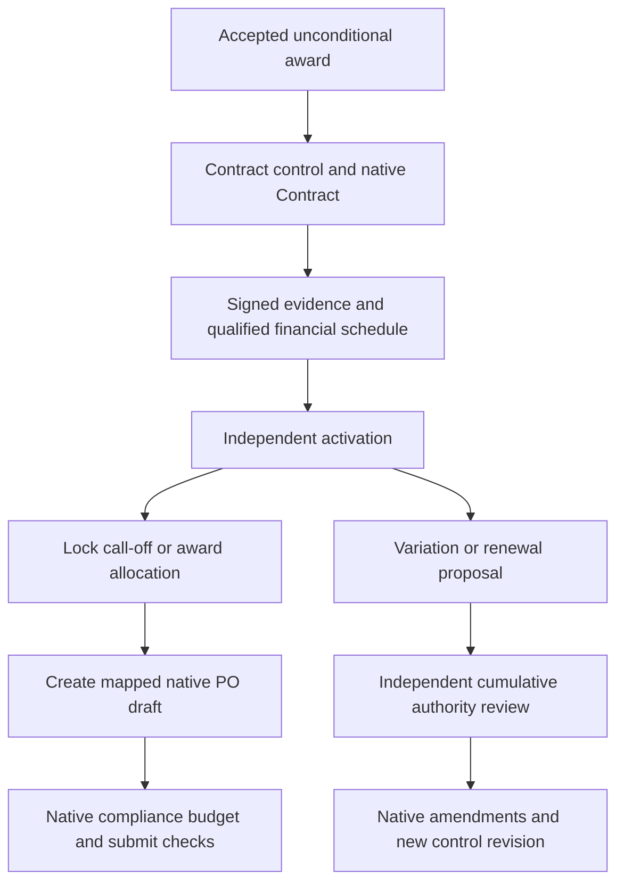

# Contracts, variations and order allocation

Policy owner: [specification](../CONTRACTS_AND_FULFILMENT.md); primary UI: [screen](../pages/CONTRACTS.md).

## Entry, ownership and transaction boundary

Contract control carries company/award authority missing from a generic signed flag. Obligations, guarantees, milestone acceptance and enabled advance/retention treatment must be complete before activation.

## Decisions and durable effects

Order generation is same-site transactional and idempotently mapped to the source version. Reserve quantities/value for active drafts; recheck native validation at submission. Framework call-offs also respect blanket validity and remaining owned allowance.

## Exceptions and recovery

Contract expiry, changed bank/compliance, missing guarantee or complaint hold blocks relevant new commitment. Variations require cumulative authority and supplier acceptance; submitted documents use native amendments. Reconciliation releases only proven cancelled/abandoned reservations.

## Required verification

[PROC-A19](../TESTING_AND_ACCEPTANCE.md#proc-a19), [PROC-A20](../TESTING_AND_ACCEPTANCE.md#proc-a20), [PROC-A21](../TESTING_AND_ACCEPTANCE.md#proc-a21), [PROC-A29](../TESTING_AND_ACCEPTANCE.md#proc-a29).
