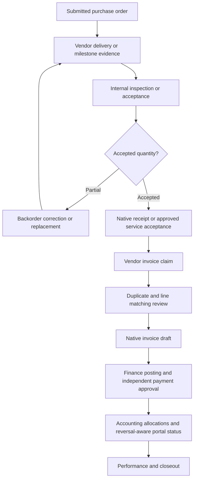

# Delivery, acceptance, claims and settlement visibility

Policy owner: [specification](../CONTRACTS_AND_FULFILMENT.md); primary UI: [screen](../portal/INVOICE_CLAIMS_AND_PAYMENTS.md).

## Entry, ownership and transaction boundary

PO acknowledgement/change requests create a reviewable order response; only an authorised internal decision can amend native terms. Vendor evidence is reported work, never stock receipt or payment entitlement. Internal acceptance records source quantities, inspection and any conflict-driven second approval. Returns/reversals retain links and downstream impact.

## Decisions and durable effects

Claims lock the invoice-number registry and source allowance, compare goods against receipts or services against acceptance, and create at most one native invoice draft per approved revision. Finance alone submits/posts and prepares payments using verified bank data and independent approval.

## Exceptions and recovery

Partial/rejected work, match tolerance, duplicate native invoice, credit note, advance recovery, retention and reversed payments have explicit outcomes. Portal payment status discloses accounting as-of time and never asserts bank clearance. Financial close waits for settlement/holds/disputes.

## Required verification

[PROC-A09](../TESTING_AND_ACCEPTANCE.md#proc-a09), [PROC-A21](../TESTING_AND_ACCEPTANCE.md#proc-a21), [PROC-A22](../TESTING_AND_ACCEPTANCE.md#proc-a22), [PROC-A23](../TESTING_AND_ACCEPTANCE.md#proc-a23), [PROC-A24](../TESTING_AND_ACCEPTANCE.md#proc-a24), [PROC-A25](../TESTING_AND_ACCEPTANCE.md#proc-a25).
