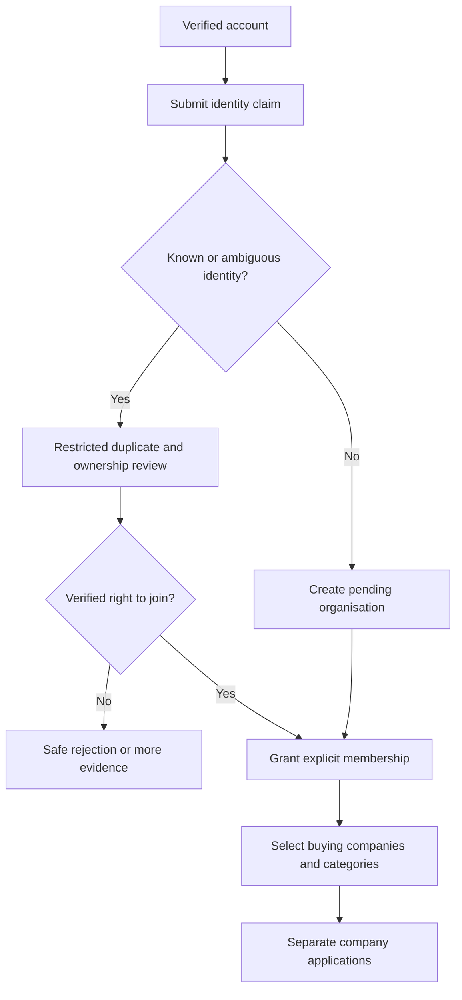

# Identity, membership and onboarding

Policy owner: [specification](../REGISTRATION_AND_COMPLIANCE.md); primary UI: [screen](../portal/REGISTRATION.md).

## Entry, ownership and transaction boundary

Entry is a verified Frappe account; email/domain matching is not membership. Organisation claim and membership changes commit with audit and unique identity/membership checks. A reviewer resolves duplicate/legal identity ownership without disclosing existing confidential records to the claimant.

## Decisions and durable effects

An owner invites contributors with explicit capabilities and token expiry; acceptance is bound to the verified intended user. Multiple organisations require explicit context switching. Bank changes take a separate finance-verification path and never piggyback on ordinary profile edits.

## Exceptions and recovery

Replayed/expired invitations, last-owner removal and disputed identity are blocked. Legacy Supplier import does not create active membership. Recovery needs independent ownership evidence and preserves old authorship/history.

## Required verification

[PROC-A03](../TESTING_AND_ACCEPTANCE.md#proc-a03), [PROC-A04](../TESTING_AND_ACCEPTANCE.md#proc-a04), [PROC-A09](../TESTING_AND_ACCEPTANCE.md#proc-a09), [PROC-A10](../TESTING_AND_ACCEPTANCE.md#proc-a10), [PROC-A28](../TESTING_AND_ACCEPTANCE.md#proc-a28).
