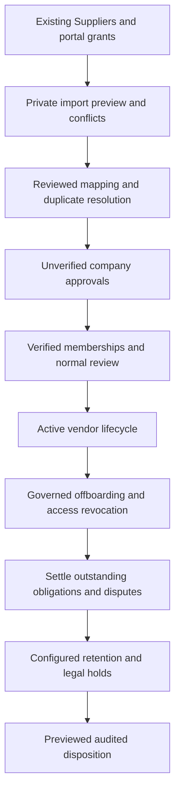

# Legacy migration, retention and offboarding

Policy owner: [specification](../PERMISSIONS_AND_PRIVACY.md); primary UI: [screen](../pages/VENDOR_DATABASE.md).

## Entry, ownership and transaction boundary

Preview imports in bounded resumable operations and confirm the exact selection hash. Preserve original Supplier IDs and submitted accounting documents; no imported row auto-approves a vendor, bank account or portal user.

## Decisions and durable effects

Before launch reconcile native Supplier portal grants against explicit organisation capabilities and the managed purchasing perimeter. Offboarding closes future sourcing eligibility and removes unnecessary access while retaining existing legitimate obligations and historical authorship.

## Exceptions and recovery

Unresolved duplicate identity blocks activation rather than merging legal entities. Erasure/retention respects holds and native financial history. Cleanup is previewed and idempotent; a restore must retain revocations/suppression state before any portal or notification re-enable.

## Required verification

[PROC-A04](../TESTING_AND_ACCEPTANCE.md#proc-a04), [PROC-A08](../TESTING_AND_ACCEPTANCE.md#proc-a08), [PROC-A10](../TESTING_AND_ACCEPTANCE.md#proc-a10), [PROC-A25](../TESTING_AND_ACCEPTANCE.md#proc-a25), [PROC-A28](../TESTING_AND_ACCEPTANCE.md#proc-a28), [PROC-A29](../TESTING_AND_ACCEPTANCE.md#proc-a29), [PROC-A30](../TESTING_AND_ACCEPTANCE.md#proc-a30).
