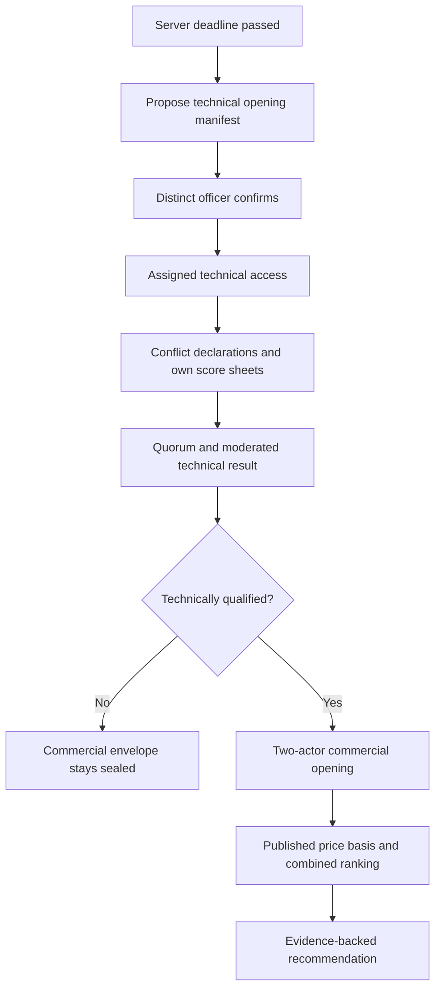

# Opening, scoring and commercial release

Policy owner: [specification](../TENDERING_AND_EVALUATION.md); primary UI: [screen](../pages/EVALUATION.md).

## Entry, ownership and transaction boundary

Opening fixes the effective bid manifest and releases only the required stage to assigned non-conflicted users. Opening officers do not acquire universal content access. A second distinct confirmer verifies the manifest and technical qualification revision.

## Decisions and durable effects

Evaluators submit immutable own scores with evidence. Moderation uses effective sheets and configured quorum; incomplete is not zero. Technical pass gates precede price release. Commercial comparison uses the published currency, quantities, tax basis, score precision, weights and tie procedure. Expired validity requires explicit vendor consent in a reviewed offer revision before a new recommendation.

## Exceptions and recovery

Recusal immediately revokes subsequent access. Superseded scores regenerate summary approval. Generic File/API/print/report/search routes remain stage-gated. Unexpected price content in a technical document triggers a restricted incident/disposition without rewriting source evidence.

## Required verification

[PROC-A16](../TESTING_AND_ACCEPTANCE.md#proc-a16), [PROC-A17](../TESTING_AND_ACCEPTANCE.md#proc-a17), [PROC-A18](../TESTING_AND_ACCEPTANCE.md#proc-a18), [PROC-A28](../TESTING_AND_ACCEPTANCE.md#proc-a28).
