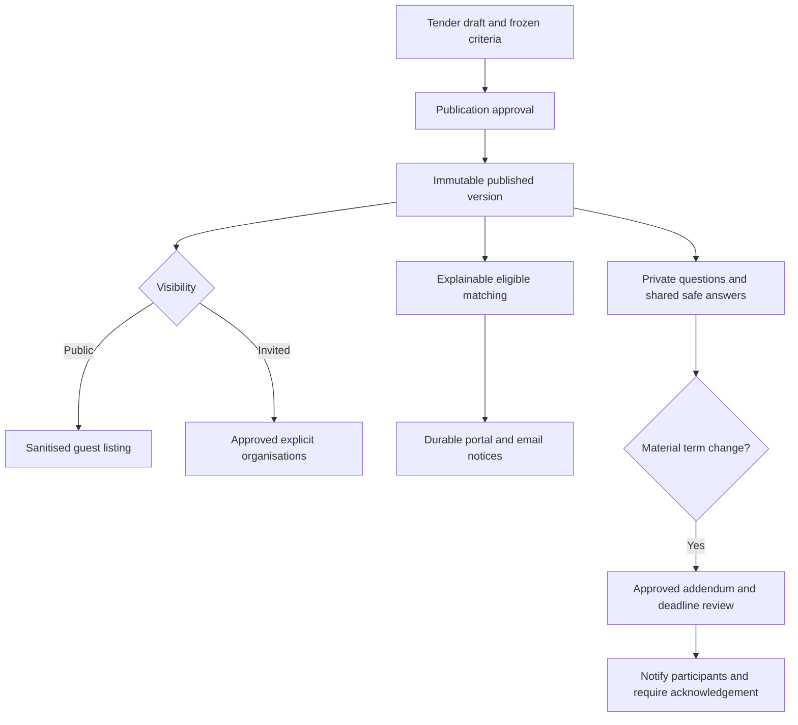

# Tender publication, matching and shared changes

Policy owner: [specification](../TENDERING_AND_EVALUATION.md); primary UI: [screen](../pages/TENDERS.md).

## Entry, ownership and transaction boundary

Publication approval checks policy, schedule, requirements, price schedule, assigned panel and exact content hash. The safe public projection and immutable terms commit with durable notification events; sending is asynchronous.

## Decisions and durable effects

Optional public job matching applies current approval, category/coverage and subscription. Explicit invitation and essential participant notices have separate purpose rules. Shared answers remove vendor identity/commercial details; only an addendum changes terms.

## Exceptions and recovery

Queued optional alerts recheck subscription/current tender state. Essential addenda reach recorded participants despite opt-out or subsequent expiry. Structural criteria/currency/lot changes after a submission require reissue; no hidden edits or post-close silent extension.

## Required verification

[PROC-A13](../TESTING_AND_ACCEPTANCE.md#proc-a13), [PROC-A14](../TESTING_AND_ACCEPTANCE.md#proc-a14), [PROC-A15](../TESTING_AND_ACCEPTANCE.md#proc-a15), [PROC-A26](../TESTING_AND_ACCEPTANCE.md#proc-a26).
