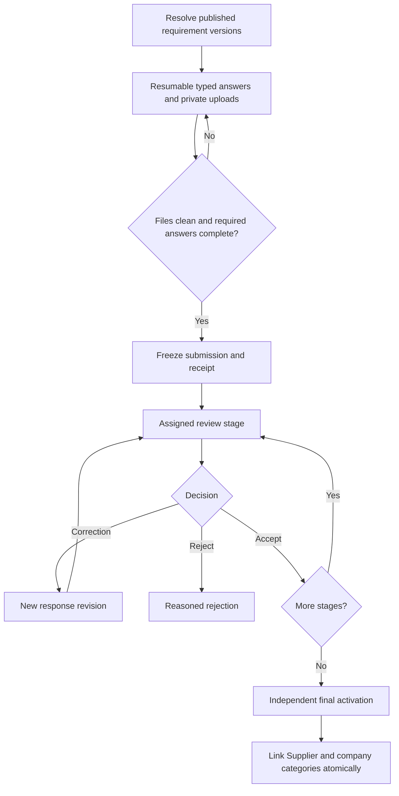

# Configurable registration and review

Policy owner: [specification](../REGISTRATION_AND_COMPLIANCE.md); primary UI: [screen](../portal/APPLICATION_PROGRESS.md).

## Entry, ownership and transaction boundary

Application creation resolves the company base and applicable category/country/work-type versions. Submission freezes only active required answers, declarations and clean evidence references under revision checks. Progress counters describe completeness independently of review outcomes.

## Decisions and durable effects

Each review decision is evidence/submission-specific. Corrections create a new revision; affected stages reset. Final activation checks valid waivers, all stage slots, duplicate resolution and independent actor before company approval/Supplier linking in one transaction.

## Exceptions and recovery

Pending scans, conflicting packs, stale revisions or missing reviewers leave the application incomplete or blocked with a precise next action. Withdrawal closes tasks; rejection remains historical and a reapplication links back rather than erasing it.

## Required verification

[PROC-A05](../TESTING_AND_ACCEPTANCE.md#proc-a05), [PROC-A06](../TESTING_AND_ACCEPTANCE.md#proc-a06), [PROC-A07](../TESTING_AND_ACCEPTANCE.md#proc-a07), [PROC-A09](../TESTING_AND_ACCEPTANCE.md#proc-a09).
