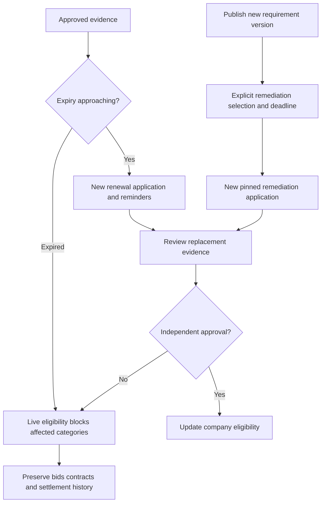

# Expiry, renewal and policy remediation

Policy owner: [specification](../REGISTRATION_AND_COMPLIANCE.md); primary UI: [screen](../portal/COMPLIANCE_DOCUMENTS.md).

## Entry, ownership and transaction boundary

Expiry is enforced during every eligibility command even when scheduled status projection is late. A reminder scan schedules tasks; it cannot extend evidence validity. Current approval remains effective during a renewal only while its existing requirements remain valid.

## Decisions and durable effects

A new policy version does not rewrite submitted applications. An authorised remediation campaign previews affected categories, specifies a deadline/hold policy and creates linked work. Migration of an in-review application requires explicit applicant acknowledgement and renewed affected reviews.

## Exceptions and recovery

Revoked evidence grants stop new reuse, not legitimate retained decision evidence. Open bids remain in history during a compliance hold; award and new order checks require restored eligibility. Existing contract suspension and settlement need explicit separate decisions.

## Required verification

[PROC-A05](../TESTING_AND_ACCEPTANCE.md#proc-a05), [PROC-A07](../TESTING_AND_ACCEPTANCE.md#proc-a07), [PROC-A08](../TESTING_AND_ACCEPTANCE.md#proc-a08), [PROC-A26](../TESTING_AND_ACCEPTANCE.md#proc-a26).
