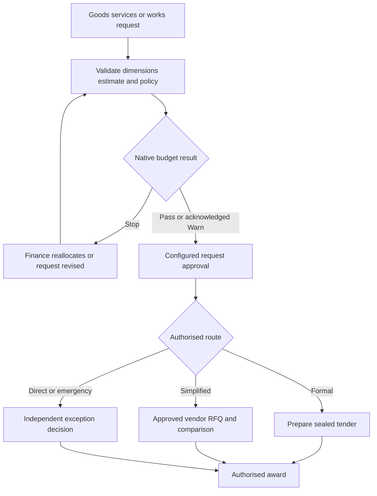

# Request, budget authority and sourcing route

Policy owner: [specification](../PROCUREMENT_POLICY.md); primary UI: [screen](../pages/PROCUREMENT_REQUESTS.md).

## Entry, ownership and transaction boundary

Capture source request lines with company/project/cost-centre/account and a disclosed conversion/estimate basis. Resolve complete published authority bands; missing thresholds do not default to low-value approval. Material changes invalidate pending decisions.

## Decisions and durable effects

Native budget validation is retained at request/order/expense stages. Planning approval is not a second ledger reservation. RFQ is intentionally unsealed; formal tender routes use owned envelopes. All routes converge on current compliance and independent award/financial authority; RFQ/direct awards retain their own request/quotation/exception references without fabricated tender or score records.

## Exceptions and recovery

Insufficient quotes, sole source and emergencies need typed exceptions with evidence and expiry. No exception bypasses native Budget Stop, verified banking or independent sensitive approvals. Linked native demand and source lines reconcile through mapping records.

## Required verification

[PROC-A11](../TESTING_AND_ACCEPTANCE.md#proc-a11), [PROC-A12](../TESTING_AND_ACCEPTANCE.md#proc-a12), [PROC-A21](../TESTING_AND_ACCEPTANCE.md#proc-a21).
